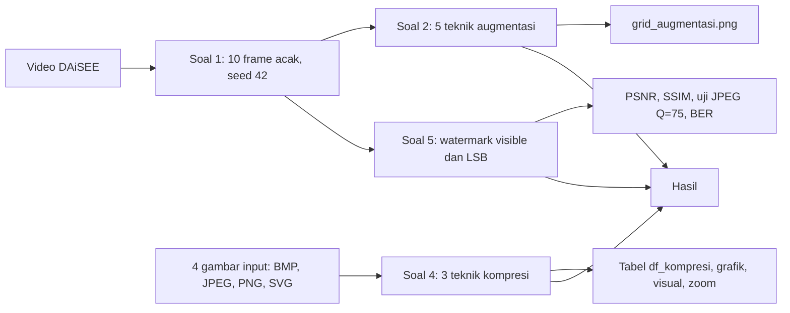

# Tugas 2 Komputasi Multimedia: Transformasi Gambar, Image Compression, dan Watermarking

Kelompok CS5:

| Nama | NIM |
|---|---|
| Yosafat Jacobus | 105224016 |
| Michael Alexander Newton | 105224017 |
| Arif Mufti Tharsa | 105224041 |

Bagian kode dikerjakan oleh Arif Mufti Tharsa.

## Struktur folder

```
Kode/       notebook KM_Notebook_Tugas-2-Transformasi-Gambar.ipynb dan requirements.txt
Data/       DAiSEE/ (tidak di-push) dan Gambar_Kompresi/ (input.bmp, input.jpg, input.png, input.svg)
Hasil/      keluaran notebook: A_Augmentasi, B_Kompresi, C_Watermarking
Document/   laporan Word Hasil dan Analisis (berkas docx tidak di-push)
outputs/    cadangan lokal (tidak di-push)
```

Isi folder Hasil:

| Folder | Isi |
|---|---|
| A_Augmentasi | 0_Original (10 frame asli), 1_Flip sampai 5_Crop-Scale (10 PNG per teknik), grid_augmentasi.png |
| B_Kompresi | 12 hasil kompresi, svg_render.bmp, grafik_kompresi.png, visual_kompresi.png, visual_kompresi_zoom.png |
| C_Watermarking | watermark_visible.png, watermark_lsb.png, evaluasi_watermarking.png |

## Alur notebook



## Cara menjalankan

```powershell
pip install -r Kode/requirements.txt
```

Buka notebook di folder Kode, lalu Run All dari atas ke bawah. Notebook memakai path relatif ke folder Data dan Hasil, jadi jalankan dari folder Kode.

Kode diuji dengan versi berikut:

| Komponen | Versi |
|---|---|
| Sistem operasi | Windows 11 Home 10.0.26300 |
| Python | 3.14.6 |
| Pillow | 12.3.0 |
| OpenCV | 5.0.0 |
| scikit-image | 0.26.0 |
| NumPy | 2.5.2 |
| pandas | 3.0.6 |
| Matplotlib | 3.11.2 |
| PyMuPDF | 2.1 |

## Data

1. DAiSEE diunduh lewat formulir di https://people.iith.ac.in/vineethnb/resources/daisee/ lalu diletakkan di `Data/DAiSEE/`. Folder ini tidak ikut repositori karena ukurannya besar.
2. Empat gambar input Soal 4 sudah termasuk di `Data/Gambar_Kompresi/`: `input.bmp`, `input.jpg`, `input.png`, dan `input.svg`.
Foto input.bmp, input.jpg, dan input.png diambil dari internet dan dipakai hanya untuk keperluan tugas kuliah. Sumber aslinya tidak tercatat. File input.svg adalah ilustrasi sederhana yang dibuat untuk tugas ini.

## Catatan hak cipta

Output notebook dan folder Hasil memuat frame dari dataset DAiSEE. Frame tersebut hanya untuk riset. © Vineeth Balasubramanian.

Referensi dataset:

- Gupta, A., D'Cunha, A., Awasthi, K., & Balasubramanian, V. (2016). DAiSEE: Towards user engagement recognition in the wild. arXiv. https://doi.org/10.48550/arXiv.1609.01885
- Kamath, A., Biswas, A., & Balasubramanian, V. (2016). A crowdsourced approach to student engagement recognition in e-learning environments. In Proceedings of the IEEE Winter Conference on Applications of Computer Vision (WACV) (pp. 1-9). IEEE. https://doi.org/10.1109/WACV.2016.7477618
